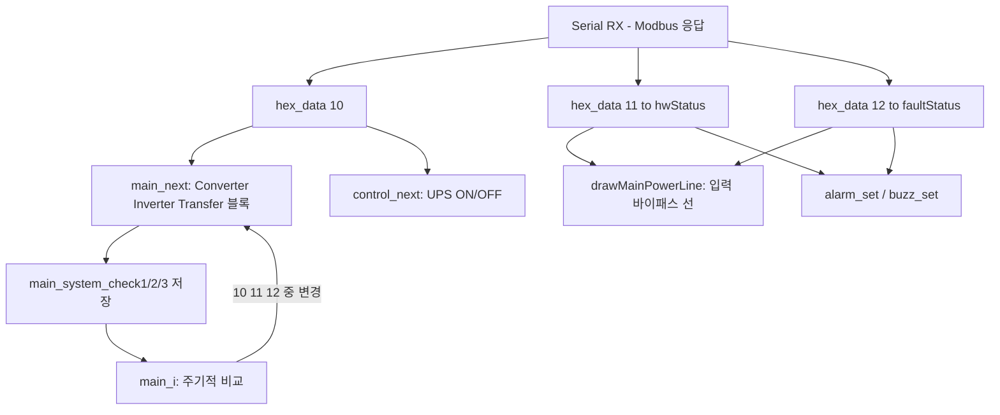

# Touch_1pUPS_335_bypass

1상 UPS 3.35인치 터치 디스플레이 펌웨어. UPS 본체와 Modbus(RS-485)로 통신하며, 수신한 `hex_data[]` 값을 바탕으로 메인 화면 다이어그램·알람·제어 UI를 갱신한다.

보드: **Arduino Due (Programming Port)** (`arduino:sam:arduino_due_x_dbg`, 업로드 COM5)

관련 문서: [DIFF_vs_Touch_1pUPS_335_bat.md](DIFF_vs_Touch_1pUPS_335_bat.md) (`_bat` 대비 차이)

---

## 빌드

Arduino IDE 2와 Cursor(이 폴더) 모두 Due로 컴파일할 수 있다.

### Arduino IDE

1. 보드: `Arduino ARM (32-bits) Boards` → `Arduino Due (Programming Port)`
2. 스케치 폴더를 연 뒤 컴파일/업로드
3. IDE는 기본적으로 `문서\Arduino\libraries` 를 쓴다. 이 저장소의 `libraries/` 와 **같은 버전**을 맞춰 두었다.

### Cursor / 명령줄 (`compile.ps1`)

Arduino IDE 2에 포함된 `arduino-cli`와 **이 저장소 `libraries/`** 를 사용한다. OneDrive 스케치북이 없어도 된다.

```powershell
.\compile.ps1                         # 컴파일만
.\compile.ps1 -ListPorts              # 포트 목록
.\compile.ps1 -Upload                 # 컴파일 + 업로드 (기본 COM5)
.\compile.ps1 -Upload -Monitor        # 컴파일 + 업로드 + 시리얼(9600)
.\compile.ps1 -Monitor                # 시리얼만 (컴파일도 함)
.\compile.ps1 -Upload -Port COM7      # 포트가 바뀌었을 때
```

산출물: `build/Touch_1pUPS_335_bypass.ino.bin` (업로드용으로 `upload\` 에도 복사)

Due **Programming Port**(COM5)는 `upload\bossac.exe` 로 올린다. `upload\upload.bat` 과 동일한 옵션이다.

```
bossac -i -d --port=COM5 -U false -e -w -b -v <bin> -R
```

`-U false` 가 Programming Port다. Native USB(`arduino:sam:arduino_due_x`, `-U true`)로 올리면 COM5에서는 플래시는 되는 것처럼 보여도 부팅이 잘못될 수 있다.

모니터는 Programming Port 리셋을 막기 위해 `dtr=off,rts=off` 이다. COM 점유 중이니 다시 업로드하려면 `Ctrl+C` 로 끊는다.  
보드레이트 기본 9600 (`Serial.begin(9600)`, `-Baud`로 변경).

### 프로젝트에 포함한 라이브러리

`libraries/` 에 이 스케치가 쓰는 3rd-party 라이브러리만 넣었다. `SPI` 는 Due 코어에 있으므로 포함하지 않았다.

| 라이브러리 | 용도 | 비고 |
|------------|------|------|
| arduino_uip (UIPEthernet) | ENC28J60 이더넷 | |
| SdFat | SD 카드 | examples 제외 |
| UTFT / URTouch / UTFT_Buttons / UTFT_SdRaw | 터치 LCD | Image-files·examples 제외 |
| DueTimer | 타이머 | |
| RTCDue | RTC | |
| SPIMemory | SPI 플래시 | examples/docs 제외 |
| DueFlashStorage | Due 내부 플래시 | |

컴파일에 필요 없는 `examples`, `docs`, `Image-files`(약 36MB)는 넣지 않았다.

---

## hex_data 개요

`hex_data[]`는 UPS에서 수신한 Modbus Holding Register 값을 저장하는 배열이다. 화면 그래픽과 직접 관련된 번지는 아래 세 개가 핵심이다.

| 번지 | Modbus | 구조체 | 주 역할 |
|------|--------|--------|---------|
| `hex_data[10]` | 10번지 | `ups_converter_status` | **UPS 동작 상태** — Converter·DC/DC·Inverter·Transfer RUN/STOP |
| `hex_data[11]` | 11번지 | `ups_hw_status` (`hwStatus`) | **H/W 고장 상태** — Input OC, Bypass Failure 등 |
| `hex_data[12]` | 12번지 | `ups_operation_fault_status` (`faultStatus`) | **운전/소프트웨어 고장** — Utility line failure, Bypass mode 등 |

시리얼 수신 시 `hwStatus.value`, `faultStatus.value`에 각각 대입된다.

```cpp
hwStatus.value   = hex_data[11];
faultStatus.value = hex_data[12];
```

---

## 화면 그래픽 제어 요약

메인 화면 UPS 전력 흐름 다이어그램은 **구간별로 제어 데이터가 다르다.**

```
[입력/바이패스 전원선]          [Converter 구간]        [Inverter·Transfer·출력 구간]
hex_data[11], hex_data[12]  →  hex_data[10]      →   hex_data[10]
(drawMainPowerLine)            (비트 D00~D02)         (비트 D02~D03)
```

- **Converter 및 후단(Inverter → Transfer → 출력) 파워라인·블록**은 `hex_data[10]` 비트만으로 색상·ON/OFF 표시가 결정된다.
- **전단(입력·Utility·바이패스) 전원선**은 `hex_data[11]`·`hex_data[12]`가 `hwStatus`/`faultStatus`로 변환된 뒤 `drawMainPowerLine()`에서 그려진다.

---

## hex_data[10] — UPS 동작 상태 (메인·제어 화면 핵심)

### 비트 정의

| 비트 | 신호 | 의미 |
|------|------|------|
| D00 | CONVERTER RUN/STOP | 0: STOP, 1: RUN |
| D01 | DC/DC CONVERTER RUN/STOP | 0: STOP, 1: RUN |
| D02 | INVERTER RUN/STOP | 0: STOP, 1: RUN |
| D03 | TRANSFER RUN/STOP | 0: STOP, 1: RUN |
| D04 | Battery Discharging TEST MODE | 0: STOP, 1: RUN |
| D06 | (제어 화면) UPS RUN/STOP | ON/OFF 버튼 표시에 사용 |

### 메인 화면 (`main_next` / `main_i`)

`main_next`에서 비트를 순차적으로 읽어 `myGLCD.fillRect()` 등으로 블록 색을 변경한다.

| 비트 | 대상 UI | RUN(1) | STOP(0) |
|------|---------|--------|---------|
| D00 | Converter 블록·DC 링크 | GREEN / BLUEGREEN | LIGHT_GRAY / SOFT_GRAY |
| D01 | DC/DC·배터리 링크 | GREEN | LIGHT_GRAY |
| D02 | Inverter 블록·INV 링크 | GREEN / BLUEGREEN | LIGHT_GRAY / SOFT_GRAY |
| D03 | Transfer(STS)·출력·바이패스 후단 | GREEN / 주황 STS | LIGHT_GRAY / 회색 STS |

`main_i`에서는 `main_system_check1`과 `hex_data[10]`을 비교해 값이 바뀌면 `main_next`로 돌아가 화면을 다시 그린다.

### 제어 화면 (`control_next` / `control_i`)

```cpp
control_alarm = hex_data[10];
control_check = (control_alarm >> 6) & 0x0001;  // UPS ON/OFF 버튼
```

---

## hex_data[11] — H/W 상태 (`hwStatus`)

### 비트 정의 (주요 항목)

| 비트 | 신호 | 의미 |
|------|------|------|
| D00~D11 | Input_OC, Inverter OC, Vdc_OV, … | H/W Latch 고장 |
| D12 | SNMP Buzzer On/Off | Toggle |
| D13 | EEPROM Error | 1: Fault |
| D14 | Bypass Failure | 1: Fault |

### 화면에서의 사용

| 용도 | 함수/위치 | 설명 |
|------|-----------|------|
| 전단 전원선 그리기 | `drawMainPowerLine()` | `hwStatus.bypass_failure` — 바이패스 선 색상 |
| Transfer 구간 보조 | `main_next` (3453행) | `hwStatus.bypass_failure`일 때 출력 링크 색 보정 |
| 화면 갱신 감지 | `main_i` | `main_system_check3`와 비교 |
| 알람 화면 | `alarm_set()`, `buzz_set()` | `alarm_data2`로 알람 비트 카운트·목록 표시 |
| 부저·EEPROM | `eeprom_set()` | 비트 변화 시 EEPROM 기록, SNMP 부저 제어 |

`hex_data[10]`처럼 비트별로 Converter/Inverter 블록을 직접 그리지는 **않는다.**

---

## hex_data[12] — 운전/고장 상태 (`faultStatus`)

### 비트 정의 (주요 항목)

| 비트 | 신호 | 의미 |
|------|------|------|
| D00~D06 | Input current limit, Vdc link, 주파수 등 | Latch/Hold 고장 |
| D07 | utility line failure | 입력 전압 50% 이하 |
| D08~D13 | Battery, Inverter output, Over load 등 | 운전 고장 |
| D15 | Bypass mode | 바이패스 모드 |

### 화면에서의 사용

| 용도 | 함수/위치 | 설명 |
|------|-----------|------|
| 전단 전원선 그리기 | `drawMainPowerLine()` | `faultStatus.utility_line_failure` — Utility·입력 선 색상 |
| 화면 갱신 감지 | `main_i` | `main_system_check2`와 비교 |
| 알람 화면 | `alarm_set()`, `buzz_set()` | `alarm_data1`로 알람 비트 카운트·목록 표시 |
| 부저·EEPROM | `eeprom_set()` | 비트 변화 시 EEPROM 기록 |

> 참고: `main_next`에 `hex_data[12] >> 7`(utility line failure)을 읽는 코드가 있으나, 해당 구간 직접 그리기는 주석 처리되어 있고 실제 전원선은 `drawMainPowerLine()`의 `faultStatus`를 사용한다.

---

## 화면 갱신 흐름



`main_next` 종료 시 세 값을 스냅샷으로 저장한다.

```cpp
main_system_check1 = hex_data[10];
main_system_check3 = hex_data[11];
main_system_check2 = hex_data[12];
```

`main_i` 루프에서 어느 하나라도 달라지면 `page_num = main_next`로 전환해 다이어그램을 재그린다.

---

## 관련 소스 위치

| 내용 | 파일 | 대략적 위치 |
|------|------|-------------|
| 비트 정의·구조체 | `Touch_1pUPS_335_bypass.ino` | 263~365행 |
| 시리얼 수신·구조체 대입 | 동일 | 1586~1589행 |
| 전단 전원선 | `drawMainPowerLine()` | 2997~3037행 |
| 메인 다이어그램 | `main_next` / `main_i` | 3332~3605행 |
| 제어 화면 | `control_next` / `control_i` | 3771~3832행 |
| 알람·부저 | `buzz_set()`, `alarm_set()`, `eeprom_set()` | 1460~1515, 1806~1844행 |

---

## 한 줄 정리

- **`hex_data[10]`** — Converter·DC/DC·Inverter·Transfer·출력 후단 파워라인/블록의 **RUN·STOP 표시를 직접 제어**한다.
- **`hex_data[11]`** — H/W 고장·바이패스 상태 → **전단 전원선**, 알람, 부저, 화면 갱신 트리거.
- **`hex_data[12]`** — 운전/소프트웨어 고장 → **전단 Utility 전원선**, 알람, 화면 갱신 트리거.
